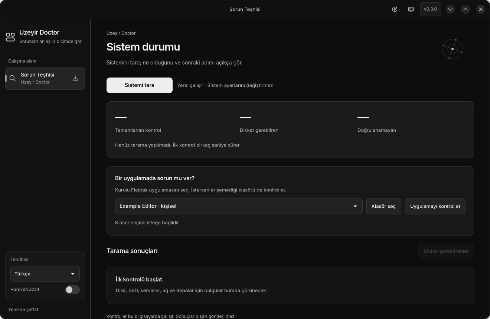
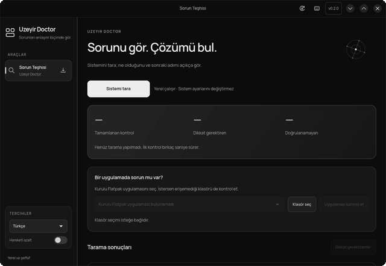
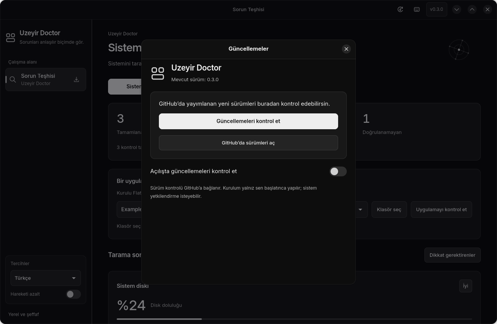

# Uzeyir Doctor

[](https://github.com/Tubix777/uzeyir-doctor/actions/workflows/tests.yml)
[](https://github.com/Tubix777/uzeyir-doctor/releases)
[](COPYING)

**Sorunu gör. Çözümü bul.**

Uzeyir Doctor, Linux'taki yaygın sorunları kontrol eden ve bulgularını anlaşılır
Türkçe veya İngilizce açıklayan yerel bir GTK 4 / libadwaita uygulamasıdır.
Bir kontrolün kanıtını, ne anlama geldiğini ve sonraki adımı aynı yerde gösterir.

[İndir](https://github.com/Tubix777/uzeyir-doctor/releases/tag/v0.3.0) ·
[Kurulum](docs/install.md) · [Sürüm notları](docs/release-notes.md) ·
[Sorun bildir](https://github.com/Tubix777/uzeyir-doctor/issues)



*Arayüz önizlemesi. Yerel sistem veya kişisel tarama çıktısı içermez.*

## Neleri kontrol eder?

| Alan | Kontrol |
| --- | --- |
| Diskler | Sistem ve kişisel dosya alanındaki boş kapasite |
| SSD | Uygun ve güncel NVMe SMART kaydı varsa kalan dayanıklılık tahmini ve kritik uyarılar |
| Servisler | Başarısız sistem ve kullanıcı servisleri |
| Ağ | NetworkManager'ın bildirdiği bağlantı durumu |
| Depolar | RPM depo tanımlarındaki yapılandırma sorunları |
| Flatpak | Uygulama kurulumu, çalışma ortamı ve seçilen yerel klasöre erişim |

Kontroller arka planda çalışır. Sonuçlar kanıt ve önerilen adımlarla sunulur.
Erişilemeyen veri açıkça belirtilir. SSD yüzdesi üreticinin dayanıklılık tahminidir;
genel bir sağlık garantisi değildir. Ağ bağlantısı internet erişimini tek başına
kanıtlamaz. Uygulama onarım uygulamaz veya sistem ayarlarını değiştirmez.

## 0.3.0 deneyimi

Graphite görünümü daha okunaklı bir yazı düzeni ve sakin mat yüzeyler sunar.
Inter pakete dahildir; açılışta font indirilmez. Sayfalar 300 ms içinde kısa bir
hareketle geçiş yapar; hızlı seçimler görünen kareden devam eder. Büyütülmüş
metinler, ortak düğme ölçüleri ve dar pencerede iki satıra geçen Flatpak
kontrolleri bütün ekranlarda aynı düzeni korur.


- Sayfa ve indirme ekranı arasında kısa, yumuşak geçişler; hızlı tıklamada görünen
  kareden devam eden hareket ve son seçime anında yanıt.
- Tarama boyunca çalışan etkinlik görseli, tamamlanınca kısa vurgu, sonuçlara
  yumuşak kaydırma ve kademeli beliren kartlar. Elle kaydırmak otomatik hareketi durdurur.
- Açık kanıtlar dil/filtre değişince kapanmaz; başarısız tarama başarılı kontrol sayılmaz.
- Komut kopyalamada düğme üzerinde onay; liste yenilenince korunan klavye odağı.
- Siyah/gri/beyaz arayüz, uygulamaya dahil Inter yazı tipi ve canlı Türkçe/English seçimi.
- Hareket azaltma ve masaüstünün animasyon tercihi; gizli veya kapanmış sayfalarda duran hareket.



## İndir ve kur

| Sistem | v0.3.0 paketi |
| --- | --- |
| Ubuntu 24.04 / 26.04, Deepin 25, Zorin 18, Debian 13 | [DEB](https://github.com/Tubix777/uzeyir-doctor/releases/download/v0.3.0/uzeyir-doctor_0.3.0-1_all.deb) |
| Fedora 44 | [RPM](https://github.com/Tubix777/uzeyir-doctor/releases/download/v0.3.0/uzeyir-doctor-0.3.0-1.fc44.noarch.rpm) |
| Güncel Arch Linux | [pacman paketi](https://github.com/Tubix777/uzeyir-doctor/releases/download/v0.3.0/uzeyir-doctor-0.3.0-1-any.pkg.tar.zst) · [Çevrimdışı PKGBUILD/kaynak](https://github.com/Tubix777/uzeyir-doctor/releases/download/v0.3.0/uzeyir-doctor-0.3.0-arch-build.tar.gz) |
| Diğer uyumlu Linux sistemleri | [Kaynak](https://github.com/Tubix777/uzeyir-doctor/releases/download/v0.3.0/uzeyir-doctor-0.3.0.tar.gz) |

[Tüm paketler ve SHA256SUMS](https://github.com/Tubix777/uzeyir-doctor/releases/tag/v0.3.0).
Python ≥ 3.11, GTK ≥ 4.12 ve libadwaita ≥ 1.5 gerekir. Zorin 18 için Ubuntu 24.04
tabanı kullanılır. Eski dağıtımlarda asgari kütüphane sürümlerini kontrol edin.

İndirdiğiniz dosyanın bulunduğu klasörde dağıtımınıza uygun komutu çalıştırın:

```sh
# Ubuntu / Deepin / Zorin / Debian
sudo apt install ./uzeyir-doctor_0.3.0-1_all.deb

# Fedora
sudo dnf install ./uzeyir-doctor-0.3.0-1.fc44.noarch.rpm

# Arch
sudo pacman -U ./uzeyir-doctor-0.3.0-1-any.pkg.tar.zst
```

Uygulama menüsünden **Uzeyir Doctor**'ü veya terminalden `uzeyir-doctor` komutunu açın.
Uygulamanın indirme sayfası da seçilen paket için kopyalanabilir kurulum komutunu gösterir.

## Uygulama içinden güncelleme



Üst çubuktaki güncelleme düğmesi veya `Ctrl+U` ile açın. **Güncellemeleri kontrol et**
yeni kararlı GitHub sürümünü bulur. Sürüm notlarını okuyup **Güncellemeyi indir**
düğmesine basın; gerçek indirme ilerlemesi görünür ve indirme iptal edilebilir.
Paketin boyutu, GitHub'ın SHA-256 özeti ve `SHA256SUMS` kaydı eşleşmeden kurulum açılmaz.

**Kurulumu başlat**, mevcut PackageKit hizmetini kullanır ve sistemin normal
yetkilendirmesini ister. Hizmet yoksa dağıtımın paket kurucusu açılır; o da yoksa
doğrulanmış dosya için kopyalanabilir kurulum komutu gösterilir. **Kurulumu doğrula**
kurulu paket sürümünü sorgular. Başarı doğrulandıktan sonra **Yeniden başlat** ile
yeni sürüme geçin. İndirme/doğrulama hatası kurulum başlatmaz; kurulum hatası başarı
olarak gösterilmez. Çalışan uygulama kendiliğinden kapatılmaz.

**Açılışta güncellemeleri kontrol et** isteğe bağlıdır ve başlangıçta kapalıdır.
Kontrol yalnız ilgili uygulamanın herkese açık GitHub sürüm bilgilerini alır;
tanı sonuçları gönderilmez. Güncelleme otomatik kurulmaz. Bu özellik kurulduktan
sonra, sonraki sürümler GitHub Releases üzerinden uygulamaya ulaşır.

## Kullanım ve gizlilik

**Sistemi tara** ile genel kontrolleri başlatın. Flatpak için uygulamayı seçip
**Uygulamayı kontrol et** düğmesini kullanın; erişim sorunu için isteğe bağlı klasör seçin.
**Dikkat gerektirenler** filtresi doğrulanamayan sonuçları da korur. Kanıt ve çözüm
ayrıntılarını kartlardan açın. `Ctrl+1` teşhisi, `Ctrl+L` indirmeleri açar.

Tarama yerel çalışır; bulgular dışarı gönderilmez. GitHub sürüm kontrolü yalnız
istendiğinde yapılır. İndirme bağlantıları varsayılan tarayıcıda açılır. Uygulama
kurulum komutlarını kendi çalıştırmaz ve yönetici yardımcısı kurmaz.
[İzinler ve gizlilik](docs/permissions.md).

Uzeyir Doctor, [Uzeyir Control](https://github.com/Tubix777/linux-control)'den
bağımsız yayımlanır. Kendine ait uygulama kimliği, komut ve tercihler dosyasıyla
birleşik uygulamanın yanında kurulabilir.

## Kaynaktan çalıştırma ve geliştirme

Gerekli sistem kütüphaneleriyle:

```sh
./run.sh
./run.sh --language en
./run.sh --downloads

# Ayrı sanal Wayland oturumunda testler
packaging/run_checks.sh
python3 packaging/build_source.py
```

Fedora 44, Ubuntu 24.04/26.04, Deepin 25 ve Arch paket iş akışları testleri,
kurulumu ve kurulu iki görünümü doğrular. Bir kanonik kaynak arşivi bütün
paketlerde tekrar kullanılır. [Doğrulama kapsamı](docs/validation.md),
[plan](PLAN.md) ve [katkılar](ATTRIBUTION.md).

## Yardım ve katkı

[Sık sorulan sorular / sorun giderme](docs/troubleshooting.md) ·
[Katkı rehberi](docs/contributing.md) ·
[Hata veya özellik bildir](https://github.com/Tubix777/uzeyir-doctor/issues/new/choose)

## English

Uzeyir Doctor is a standalone native Linux diagnostic app. Local background checks
explain storage, SSD, service, network, repository and Flatpak findings with evidence
and next steps. Version 0.3.0 introduces Graphite surfaces and readable bundled Inter, with short interruptible transitions, copy and completion
feedback, preserved expanded findings and keyboard focus. Turkish/English, bundled
Inter typography and reduced-motion preferences are supported. Diagnostic checks are read-only and never invent missing health data. The updater uses verified packages and normal system authorization only when requested. Download the matching DEB, RPM or Arch package
from Releases; source archives, an offline Arch recipe and checksums are included.

## Lisans / License

GPL-3.0-or-later. Inter, SIL Open Font License ile sunulur.
See [COPYING](COPYING), [attribution](ATTRIBUTION.md) and `licenses/`.
